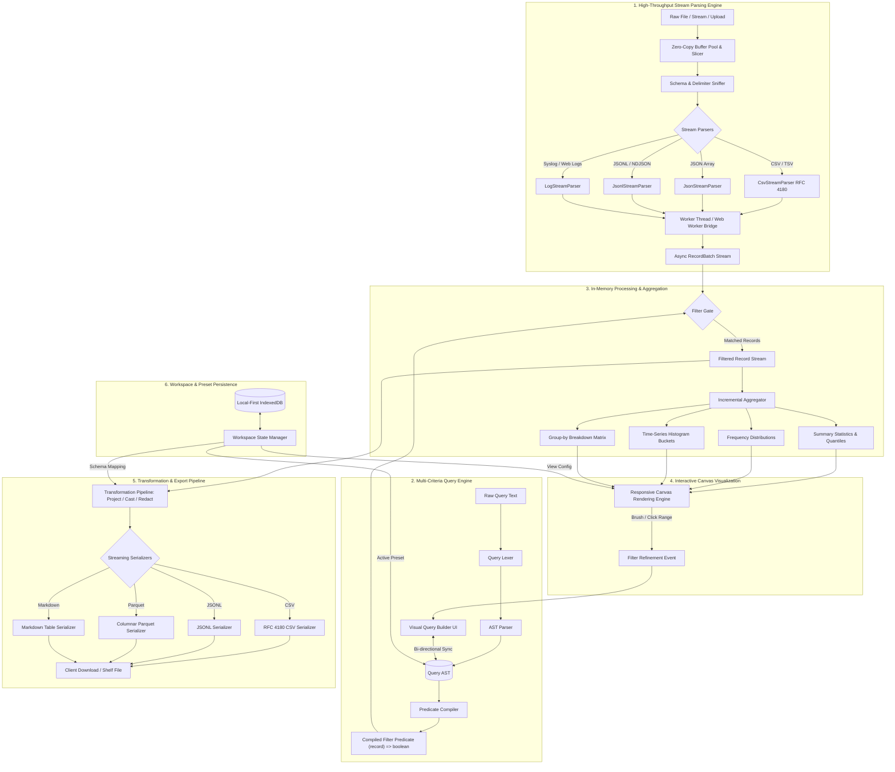

# Sift Next-Generation Architecture & Implementation Plan

## Executive Summary & Current Architecture Review

### 1. Current State (Sift v1.2.0)
Sift is currently structured as a hybrid desktop/web application:
- **Server (`server.ts`)**: Express server running on Node.js / Bun (`tsx` in dev, `esbuild` for production CJS bundle). Manages physical directory watching (`sift-workspace/watch`), sorting destinations (`sift-workspace/shelf`), a local JSON database (`sift-workspace/sift-db.json`), an Ollama proxy (`/api/ollama/proxy`), and file move/undo operations (`/api/fs/move`, `/api/fs/undo`).
- **Frontend (`src/App.tsx`)**: React 19 SPA with Tailwind CSS v4, Lucide icons, and Framer Motion. Contains a polling loop (`fetchWatchFiles` and `setInterval`) that triggers AI classification via Ollama or heuristic fallback (`src/utils/helpers.ts`), presenting files in review or auto mode.
- **Data Ingestion & Sifting**: Current processing is strictly **file-level**. Files are read synchronously in chunks of up to 1000 characters (`fs.readFileSync(fullPath, "utf-8").slice(0, 1000)`), classified into high-level categories (Documents, Images, Code, Media, Archives, Data, Design, Misc), and moved as entire units on disk.
- **Search & Filtering**: Restricted to basic lowercase string containment on filenames in `ShelfView` (`item.name.toLowerCase().includes(searchTerm.toLowerCase())`) and kind filtering in `ActivityView`.
- **Testing & CI/CD**: Zero test runners (no Vitest or Jest), zero test files, no pre-commit hooks, and no `.github` CI/CD workflows.

### 2. The Next-Generation Sift Mandate
To evolve Sift from a simple desktop file organizer into a high-performance **streaming data sifter, query parser, and visual exploration platform**, Sift requires 5 core architectural subsystems:
1. **High-Throughput Stream Parsing & Data Sifting Engine**: Chunked stream processing for large JSON, CSV, JSONL, and log files using zero-copy memory buffers (`Uint8Array` / Node `Buffer` slices) and backpressure management.
2. **Advanced Multi-Criteria Filter & Query Language**: Visual query builder and power-user expression syntax (`AND`/`OR`/`NOT`, comparisons, regex, ranges, fuzzy matching) compiling into high-speed evaluation predicates.
3. **Interactive Data Exploration & Aggregation Charts**: Incremental streaming aggregations (quantiles, frequency distributions, time-series histograms, group-by summaries) rendered on high-DPI HTML5 Canvas at 60 FPS without external bloat.
4. **Export & Transformation Pipeline**: Stream serialization and column projection pipeline supporting RFC 4180 CSV, JSONL, Apache Parquet, and Markdown table output.
5. **Saved Sift Presets & Workspace Persistence**: Local-first persistence layer (IndexedDB) for saving reusable filter pipelines, schema mappings, and view states.
6. **Jules CI/CD Automation Matrix & Engineering Standards**: Vitest test harness, `@total-typescript/shoehorn` typing fixtures, strict TDD seams, and automated GitHub Actions workflows (`jules-dispatch.yml`, `jules-diagnostics.yml`, `test.yml`, `jules-post-merge.yml`).

---

## Subsystem Architecture & Component Seams

The following diagram illustrates the component seams and data flow through the next-generation Sift engine:



---

## Detailed Component Specifications

### 1. High-Throughput Stream Parsing Engine (`area:engine`)
- **Seam**: `src/engine/stream/StreamParserInterface.ts`
- **Zero-Copy Memory Buffer Management**:
  - Employs `Uint8Array` subarrays and pooled buffer slabs rather than allocating new strings for each line or cell.
  - Chunk size defaulting to 64KB with automatic backpressure signals to pause reading when the consumer's batch queue exceeds a configurable threshold (e.g., 50 batches).
- **Format Adapters**:
  - `CsvStreamParser`: Complies with RFC 4180. Handles multiline quotes (`"line1\nline2"`), escaped quotes (`""`), custom delimiters (comma, tab, pipe, semicolon), and BOM removal.
  - `JsonStreamParser`: Streaming JSON reader parsing arrays of objects (`[{...}, {...}]`) incrementally without building a giant in-memory object tree.
  - `JsonlStreamParser`: Zero-copy line-delimiter (`\n` / `\r\n`) scanner with fast `JSON.parse` per chunk line.
  - `LogStreamParser`: Regex-optimized parsing for Common Log Format (CLF), Combined Log Format, and ISO-8601 syslog timestamps.
- **Schema & Type Inference**:
  - Reads the initial 64KB chunk to determine column keys, delimiter, and infer column types (`string`, `number`, `boolean`, `timestamp`, `json`).
- **Worker Bridge**:
  - Operates inside a Web Worker (browser) or Worker Thread (Node) to isolate computational load from React UI rendering.

### 2. Multi-Criteria Filter & Query Language (`area:query`)
- **Seam**: `src/engine/query/QueryEngine.ts`
- **Lexer & Grammar**:
  - Tokens: Identifiers, Strings (`'...'`, `"..."`), Numbers, Booleans (`true`, `false`), Null (`null`).
  - Keywords: `AND`, `OR`, `NOT`, `IN`, `BETWEEN`, `LIKE`, `MATCHES`.
  - Symbols: `==`, `!=`, `<`, `<=`, `>`, `>=`, `~`, `(`, `)`, `[`, `]`, `,`.
- **Query Expressions Supported**:
  ```text
  status == "error" AND latency > 250
  environment in ["prod", "staging"] AND (code >= 500 OR message ~ "timeout")
  timestamp between "2026-09-01" and "2026-09-12" AND path matches "^/api/v1/.*"
  ```
- **AST Definition**:
  - Discriminated union of AST nodes (`BinaryOpNode`, `UnaryOpNode`, `ComparisonNode`, `InNode`, `BetweenNode`, `RegexNode`, `FuzzyNode`).
- **Predicate Compiler**:
  - `compileQuery(ast: QueryNode): (record: Record<string, unknown>) => boolean`
  - Compiles the AST into an optimized JavaScript closure utilizing early returns for boolean short-circuiting.
- **Visual Query Builder (`src/components/query/QueryBuilder.tsx`)**:
  - Nested rule groups with `AND` / `OR` toggle.
  - Per-row field selector, operator dropdown, and input control.
  - Bi-directional sync: Edits in visual builder immediately update the text query; edits in text query are parsed into AST and reconstruct the visual builder tree without loss of state.

### 3. Interactive Data Exploration & Aggregation Canvas (`area:visualization`)
- **Seam**: `src/engine/aggregation/DataAggregator.ts` and `src/components/charts/`
- **Incremental Streaming Aggregator**:
  - Maintains running accumulator states: `count`, `nullCount`, `min`, `max`, `sum`, `sumOfSquares` (for standard deviation).
  - Categorical top-N frequency map with hash-table counters.
  - Numeric & temporal histogram binning with adaptive bin calculation (Sturges' formula or Freedman-Diaconis rule).
- **Responsive HTML5 Canvas Engine**:
  - Custom canvas rendering avoiding heavy third-party library overhead.
  - Handles `window.devicePixelRatio` for razor-sharp rendering on Retina/4K screens.
  - 60 FPS animation during streaming data intake.
  - Interactive hover state: detects mouse position against bin coordinates and displays a floating tooltip with count and percentage.
  - Brush-to-filter: Clicking or dragging across histogram bins dispatches range filter parameters directly into the active Query Engine.

### 4. Export & Transformation Pipeline (`area:pipeline`)
- **Seam**: `src/engine/transform/TransformationPipeline.ts` & `src/engine/export/`
- **Transformation Operations**:
  - Projection: Select, reorder, or exclude specific column keys.
  - Aliasing: Rename original keys to clean export headers.
  - Type coercion: Formatting timestamps into ISO-8601 or custom patterns, rounding floats, string normalization.
  - Redaction: Masking sensitive fields (e.g. hashing user IDs, redacting emails or credentials).
- **Streaming Serializers**:
  - `CsvSerializer`: Streams formatted RFC 4180 CSV rows.
  - `JsonlSerializer`: Streams valid NDJSON lines.
  - `ParquetSerializer`: Emits binary columnar Apache Parquet files using a streaming writer.
  - `MarkdownTableSerializer`: Generates GitHub-flavored Markdown tables with aligned columns for quick documentation and clipboard sharing.
- **Export Modal UI (`src/components/export/ExportModal.tsx`)**:
  - Live preview of top 5 transformed rows.
  - Column selector with drag-and-drop order adjustment.
  - Streaming download progress indicator with cancellation support.

### 5. Saved Sift Presets & Workspace Persistence (`area:workspace`)
- **Seam**: `src/engine/workspace/PresetStore.ts`
- **Local-First Storage**:
  - IndexedDB storage with schema versioning (`sift_presets_v1`).
  - Fallback to in-memory/localStorage cache.
- **Preset Data Model**:
  - Encapsulates query AST, visual rule tree, active column projections, chart configurations, and metadata (name, tags, description, timestamps).
- **Workspace UI**:
  - TopBar preset switcher dropdown with instant search.
  - Preset save, clone, export to `.json`, and import from `.json` capabilities.
  - Undo/redo integration for preset configuration edits.

---

## TypeScript Data Models & Schemas

```typescript
// --- Stream Engine Interfaces ---
export type InferredType = 'string' | 'number' | 'boolean' | 'timestamp' | 'json' | 'null';

export interface ColumnSchema {
  name: string;
  inferredType: InferredType;
  nullable: boolean;
  sampleValues: unknown[];
}

export interface RecordBatch {
  columns: string[];
  records: Array<Record<string, unknown>>;
  batchIndex: number;
  totalRecordsProcessed: number;
  isLastBatch: boolean;
}

export interface StreamParserOptions {
  delimiter?: string;
  hasHeader?: boolean;
  skipEmptyLines?: boolean;
  maxChunkSize?: number;
  encoding?: BufferEncoding;
}

export interface IStreamParser {
  sniffSchema(chunk: Uint8Array): Promise<ColumnSchema[]>;
  parseStream(stream: ReadableStream<Uint8Array>): AsyncIterable<RecordBatch>;
}

// --- Query AST Interfaces ---
export type TokenType =
  | 'IDENTIFIER' | 'STRING' | 'NUMBER' | 'BOOLEAN' | 'NULL'
  | 'AND' | 'OR' | 'NOT' | 'IN' | 'BETWEEN' | 'MATCHES' | 'FUZZY'
  | 'EQ' | 'NEQ' | 'LT' | 'LTE' | 'GT' | 'GTE'
  | 'LPAREN' | 'RPAREN' | 'LBRACKET' | 'RBRACKET' | 'COMMA';

export type QueryNode =
  | LogicalNode
  | ComparisonNode
  | InNode
  | BetweenNode
  | RegexNode
  | FuzzyNode;

export interface LogicalNode {
  type: 'LOGICAL';
  operator: 'AND' | 'OR';
  left: QueryNode;
  right: QueryNode;
}

export interface ComparisonNode {
  type: 'COMPARISON';
  field: string;
  operator: '==' | '!=' | '<' | '<=' | '>' | '>=';
  value: unknown;
}

export interface InNode {
  type: 'IN';
  field: string;
  values: unknown[];
  negated: boolean;
}

export interface BetweenNode {
  type: 'BETWEEN';
  field: string;
  min: number | string;
  max: number | string;
}

export interface RegexNode {
  type: 'REGEX';
  field: string;
  pattern: string;
  flags: string;
}

export interface FuzzyNode {
  type: 'FUZZY';
  field: string;
  target: string;
  threshold: number; // 0.0 to 1.0 similarity
}

export type RecordPredicate = (record: Record<string, unknown>) => boolean;

// --- Aggregation Interfaces ---
export interface MetricSummary {
  count: number;
  nullCount: number;
  distinctCount?: number;
  min?: number;
  max?: number;
  sum?: number;
  mean?: number;
  p50?: number;
  p90?: number;
  p99?: number;
}

export interface HistogramBin {
  binStart: number | string;
  binEnd: number | string;
  count: number;
}

export interface FrequencyItem {
  value: string;
  count: number;
  percentage: number;
}

export interface AggregationResult {
  totalRecords: number;
  metrics: Record<string, MetricSummary>;
  histograms: Record<string, HistogramBin[]>;
  frequencyDistributions: Record<string, FrequencyItem[]>;
}

// --- Transformation & Export Interfaces ---
export type ExportFormat = 'csv' | 'jsonl' | 'parquet' | 'markdown';

export interface ColumnTransformation {
  sourceKey: string;
  targetKey: string;
  included: boolean;
  typeCoercion?: 'string' | 'number' | 'boolean' | 'date_iso';
  computedExpression?: string;
  redactionPattern?: 'hash' | 'mask_email' | 'redact';
}

export interface ExportSpec {
  format: ExportFormat;
  columns: ColumnTransformation[];
  delimiter?: string;
  includeHeaders: boolean;
  prettyMarkdown?: boolean;
}

// --- Workspace & Preset Interfaces ---
export interface SiftPreset {
  id: string;
  version: 1;
  name: string;
  description?: string;
  tags: string[];
  rawQuery: string;
  queryAst?: QueryNode;
  columnTransformations: ColumnTransformation[];
  activeChartField?: string;
  activeChartType?: 'histogram' | 'frequency' | 'metrics';
  createdAt: number;
  updatedAt: number;
}

export interface WorkspaceState {
  activePresetId: string | null;
  presets: SiftPreset[];
  recentSearches: string[];
  viewMode: 'explorer' | 'stream' | 'shelf' | 'settings';
}
```

---

## Engineering Standards & Testing Strategy

### Matt Pocock Standards & Test Fixtures
- **Test Typing via `@total-typescript/shoehorn`**:
  - Tests will never use `as unknown as Type` or unsafe `as` type assertions when instantiating partial data batches, records, or AST nodes.
  - Use `fromPartial<RecordBatch>({...})` and `fromAny<QueryNode>({...})` in all test files.
  - Dedicated fixture generators in `tests/helpers/fixtures.ts`.
- **Strict Typing Discipline**:
  - TypeScript configured with `strict: true`, `noUncheckedIndexedAccess: true`, and zero `any` leaks.
  - Discriminated unions for all AST nodes, record batch events, and export serializers.

### Test-Driven Development (TDD) Protocol
1. **Vertical Slices & Seams**:
   - Each feature slice defines an explicit seam interface before writing tests.
   - Tests verify behavior exclusively through public seam methods, never asserting against internal private variables.
2. **Red-Green-Refactor Loop**:
   - Step 1 (Red): Write a failing test asserting desired public behavior using known-good literal fixtures.
   - Step 2 (Green): Implement minimal code required to satisfy the assertion.
   - Step 3 (Refactor / Code Review): Optimize, remove duplication, and verify linting/type-checking.
3. **Test Framework Configuration (`vitest.config.ts`)**:
   - Fast multi-threaded test execution.
   - JSDOM environment for React component rendering tests (`@testing-library/react`).
   - Node environment for zero-copy stream and parser benchmarks.

---

## Jules CI/CD Automation Matrix & Workflow Specifications

The repository will be governed by four automated GitHub Actions workflows and a standardized repository configuration conforming to Jules automation standards:

### 1. `.github/jules-config.yml` Specification
```yaml
version: 1

repository:
  owner: aaronwesthoff84
  default_branch: main

queue:
  paused: false
  maximum_concurrent_tasks: 2
  reconciliation_interval_minutes: 15
  use_github_project: false

areas:
  - engine
  - query
  - visualization
  - pipeline
  - workspace
  - testing

required_check_names:
  - "Lint & Typecheck"
  - "Vitest Unit & Stream Tests"

commands:
  validation:
    - npm run lint
  unit_tests:
    - npm run test
  dependency_install:
    - npm ci

risk:
  high_risk_paths:
    - .github/workflows/
    - .github/jules-config.yml
    - server.ts
  high_risk_categories:
    - stream engine core memory management
    - filesystem operations
    - CI/CD workflow security

merge:
  auto_merge_low_risk: true
  auto_merge_medium_risk: true
  auto_merge_high_risk: false
  method: squash
```

### 2. Workflow Matrix
- **`jules-dispatch.yml`**: Triggers on issue events and periodic 15-minute cron. Evaluates candidate issues with `state:ready` and `agent:jules`. Validates exact required H2 sections (`## Goal`, `## Background`, `## Scope`, `## Acceptance Criteria`, `## Exclusions`, `## Validation Expectations`), verifies that exactly one `area:*` and one `risk:*` label are assigned, and transitions eligible issues to `state:in-progress`.
- **`jules-diagnostics.yml`**: Scheduled health audit (every 6 hours) checking repository configuration, active issue concurrency, label consistency, PR linkage (`Fixes #<number>`), and CI check status.
- **`test.yml`**: Comprehensive CI validation running on every pull request across Node 20, Node 22, and Bun runners on Ubuntu and Windows. Executes `npm run lint` and `npm run test -- --coverage`.
- **`jules-post-merge.yml`**: Runs on pull request closure against `main`. Verifies merge commits, cleans up temporary labels, and updates downstream tracking.

---

## GitHub Issues Roadmap & Jules Implementation Contract

The following 6 GitHub Issues have been created with full Jules automation taxonomy:

| Issue # | Area | Risk | Title | Dependencies |
| :--- | :--- | :--- | :--- | :--- |
| **#21** | `area:testing` | `risk:medium` | [Set up Vitest test harness, shoehorn fixtures, and Jules CI/CD workflows](https://github.com/aaronwesthoff84/Sift/issues/21) | Greenfield foundation |
| **#22** | `area:engine` | `risk:high` | [Implement high-throughput stream parsing and zero-copy chunked data sifting engine](https://github.com/aaronwesthoff84/Sift/issues/22) | Blocks #23, #24, #25 |
| **#23** | `area:query` | `risk:medium` | [Implement advanced multi-criteria filter engine and visual query builder](https://github.com/aaronwesthoff84/Sift/issues/23) | Requires #22 |
| **#24** | `area:visualization` | `risk:medium` | [Build interactive canvas-based aggregation charts and live data explorer](https://github.com/aaronwesthoff84/Sift/issues/24) | Requires #22, #23 |
| **#25** | `area:pipeline` | `risk:medium` | [Develop streaming export and transformation pipeline for CSV, JSONL, Parquet, and Markdown](https://github.com/aaronwesthoff84/Sift/issues/25) | Requires #22, #23 |
| **#26** | `area:workspace` | `risk:low` | [Implement local-first saved presets and workspace persistence](https://github.com/aaronwesthoff84/Sift/issues/26) | Integrates #23, #24, #25 |

---

## Verification & Execution Gates

### Phase Gate Checkpoints
1. **Gate 1 (Harness Ready)**: Vitest, Shoehorn fixtures, and Jules CI workflows operational. `npm run test` exits 0.
2. **Gate 2 (Engine Ingestion)**: Streaming parser reads 50MB CSV/JSON/Log streams with <35MB peak heap usage.
3. **Gate 3 (Query Filtering)**: Compiled query predicate evaluates >250k records/sec; visual builder maintains zero-drift sync.
4. **Gate 4 (Interactive Exploration)**: Canvas histogram & frequency charts render 10k+ points at 60 FPS with responsive brush filtering.
5. **Gate 5 (Export & Transformation)**: Filtered stream serializes to valid CSV, JSONL, Parquet, and Markdown tables.
6. **Gate 6 (Workspace Persistence)**: Presets persist in IndexedDB across reloads, import/export cleanly, and support instant switching.
